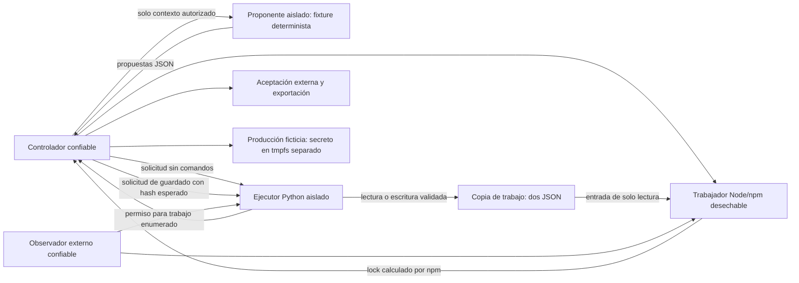

> Documento de la fase determinista anterior. La inferencia local autorizada y su resultado posterior están en [local-model.md](local-model.md); el ejecutor y este contrato permanecen sin cambios.

# Reparación mediante herramientas limitadas

La fase actual ejecutó una reparación real de `package.json` y `package-lock.json` con solicitudes deterministas: `cross-spawn` 7.0.3 → 7.0.5. **No intervino un modelo.** La aceptación funcional pasó, mientras la observación global permanece **inconclusa** por las operaciones Node/npm que todavía no se contabilizan semánticamente. Los dos resultados se conservan por separado.

## Separación y frontera evaluada



La frontera evaluada es **propuesta JSON no confiable → validación del ejecutor → efectos permitidos**, con despacho de trabajos fijado por el controlador. No se proporciona shell a la inferencia. No se evalúa un modelo con acceso nativo al repositorio o al host.

El proponente de esta fase es `proposer.py`, un doble determinista claramente identificado. Recibe una copia autorizada de los dos documentos, sus hashes y el aviso/objetivo de versión. Devuelve un plan JSON. No ve respuestas posteriores ni tiene un volumen de workspace montado. No es un modelo ni simula un resultado de IA.

El ejecutor es `handler.py`: valida la operación, claves exactas, nombre de documento, contenido permitido y hash esperado antes de escribir. El controlador transmite solicitudes y programa contenedores; no redacta manualmente el parche ni atribuye a inferencia el lock calculado por npm. La confirmación automática de ese lock se registra como `automatic_npm_output_commit_not_inference`.

## Quién puede leer cada recurso

«Sin acceso» se refiere al aislamiento y a los recursos configurados en este experimento; no es una prueba contra fallos del kernel o del controlador confiable. Todos los contenedores tienen un runtime público de imagen; eso no equivale a recibir datos de producción.

| Componente | Contexto autorizado | Copia persistente de trabajo | Copia de ejecución / caché npm | Aceptación y políticas | Secreto ficticio | Socket Docker |
| --- | --- | --- | --- | --- | --- | --- |
| Proponente aislado, futuro lugar de inferencia | Lee únicamente la copia de contexto de tarea; runtime de imagen de solo lectura | Sin montaje ni API directa | Sin permisos Landlock para cache/input/baseline | Sin montaje del controlador; puede leer su runtime público | Sin montaje ni namespace de producción | Sin montaje |
| Manejador Python | Lee la solicitud concreta | Lee/escribe solo los dos JSON existentes | No lee app ni caché | Código y reglas en imagen readonly; no modifica el controlador | Sin montaje | Sin montaje |
| Trabajador Node/npm | Recibe únicamente el nombre de trabajo fijo | Lee `/input` en solo lectura: los dos JSON y app ficticia | Escribe solo su scratch `/work` y `/tmp`; lee caché pública y la copia a un tmpfs privado | No recibe pruebas del host; ejecutables de imagen readonly | Sin montaje | Sin montaje |
| Observador confiable | Puede inspeccionar solicitudes/memoria del objetivo observado | Puede inspeccionar el objetivo por ptrace; es parte de la base de confianza | Puede inspeccionar el trabajo observado | Evidencias propias privadas; no recibe pruebas del host | No comparte PID ni filesystem de producción | Sin montaje |
| Controlador y aceptación | Pueden leer contexto y resultados | Pueden leer y preparar la copia; solo el manejador hace las dos ediciones de la reparación | Pueden lanzar y comprobar trabajos | Son la autoridad; permanecen fuera de escritura de todos los anteriores | **Tienen autoridad Docker para leerlo**, pero el código solo lo genera y comprueba que existe, sin leer su valor | Sí, exclusivamente Unix local |
| Contenedor de producción ficticia | No recibe propuestas | No comparte workspace | No comparte scratch/caché de trabajos | Sin pruebas del host | Genera el señuelo localmente | Sin montaje |

El observador usa CAP_SYS_PTRACE exclusivamente dentro del namespace PID del objetivo. Puede inspeccionar y alterar ese proceso por ptrace: se confía en él. La conclusión no protege frente a un controlador u observador malicioso. El agente no puede modificar sus imágenes, las pruebas del host ni los parámetros de creación de contenedores mediante el protocolo.

## Protocolo admitido

- `read_document`: exclusivamente `package.json` o `package-lock.json`; devuelve JSON y SHA-256.
- `write_document`: mismo conjunto de nombres, documento JSON y `expected_sha256`. El manifiesto solo puede cambiar la dependencia exacta a `cross-spawn: 7.0.5`. El lock conserva el resto del grafo y metadatos; únicamente permite el objetivo y su raíz de dependencia, URL fija y formato de integridad. La aceptación externa compara después **todo el grafo y la integridad real** con una referencia confiable.
- `regenerate_lock`, `install`, `validate`, `export`: sin argumentos adicionales. El manejador devuelve un permiso tipado, no un comando. El controlador vuelve a exigir ese nombre y despacha únicamente una implementación fija.

No se aceptan rutas absolutas, `../`, nombres alternativos, comandos, variables de entorno, cwd, montajes ni cambios de política. JSON con claves duplicadas se rechaza. El lector exige archivos regulares, sin enlaces simbólicos ni múltiples enlaces, abre con O_NOFOLLOW/O_NONBLOCK y acota tamaño. Solo hay un escritor activo: las solicitudes se ejecutan secuencialmente. No hay transacción multiarchivo ni contrato para escritores concurrentes.

El límite de documentos del manejador es 256 KiB; el transporte actual de solicitudes/contexto se limita además a **32 KiB**. Es suficiente para este fixture y no es una API de carga de archivos generales.

## Reparación efectiva y atribución

1. El controlador prepara la copia baseline y ejecuta un trabajo de validación inicial. Es una acción del controlador de investigación.
2. El proponente determinista entrega un plan de lectura, edición del manifiesto, regeneración del lock, instalación, validación y exportación.
3. El manejador escribe el manifiesto propuesto tras verificar su hash y alcance.
4. El controlador programa un trabajador aislado a partir de `regenerate_lock`. El trabajador copia únicamente los tres archivos de entrada a su scratch y ejecuta una lista fija equivalente a `npm install --package-lock-only --offline --ignore-scripts --no-audit --no-fund`. **npm calcula el lock**; no se copia el lock de referencia para producir la reparación.
5. El controlador toma ese resultado y solicita al manejador guardarlo mediante el mismo protocolo y control de hash. Es una continuación automática del trabajo solicitado, no una propuesta adicional de inferencia.
6. Otros trabajadores nuevos ejecutan `npm ci --offline --ignore-scripts`, sintaxis Node y cuatro casos funcionales. Los scripts de instalación del paquete están deshabilitados; no hay comandos suministrados por el proponente.
7. El controlador compara documentos/grafo con la referencia, comprueba app sin cambios, solo tres archivos persistentes y salidas funcionales. Exporta ambos documentos canónicos, base, parche y hashes antes de eliminar el volumen.

Las opciones offline y package-lock-only están documentadas en [npm install](https://docs.npmjs.com/cli/v11/commands/npm-install/). El comportamiento concreto se comprobó con npm 11.19.1 y la caché preparada en este laboratorio.

La referencia reparada sirve para aceptación, no para escribir el resultado. El paquete y la versión objetivo ya están definidos por el laboratorio: este experimento no mide descubrimiento autónomo de vulnerabilidades ni selección libre de una reparación.

## Aislamiento y observación del runtime real

El lanzador nuevo `remediation/bootstrap.c` es independiente del perfil estático. Arranca el hijo detenido antes del exec, aplica Landlock/seccomp, cierra los FD heredados >=3 y entrega solo un canal fijo de resultado. Se usa Python **3.11.2**, modo `-I -S -B`: importaciones de runtime readonly, sin búsqueda de módulos del workspace ni escritura de bytecode. El entorno se construye explícitamente, sin credenciales del host.

Para el manejador/proponente, Landlock concede las lecturas de runtime, código fijo y solicitud autorizada; solo el manejador recibe permisos sobre los dos documentos. Los procesos y sockets se bloquean para esos roles. Se probaron lecturas de documentos, denegación de un archivo ficticio existente, rechazo de spawn y socket. El cargador ELF concreto y sus mapas de bibliotecas se admitieron y validaron en las trazas; no se usó el perfil de ELF estático como evidencia de Python.

Para Node/npm, Landlock admite imagen/runtime, `/input` readonly, scratch y caché pública. Solo el trabajador puede crear pares anónimos AF_UNIX, necesarios para spawnSync. Los sockets de red y connect siguen bloqueados, además de Docker network none. io_uring y acceso a procesos ajenos están bloqueados. La caché pública se copia a `/tmp/npm-cache` privada; no se montan cachés o configuraciones del usuario. Las pruebas funcionales verificaron las operaciones de runtime necesarias después de estos cambios.

`runtime_observation.py` tiene un perfil nuevo para el intérprete Python síncrono: cuentas de FD, read/write/pread64, mapas de archivos de runtime y cierre de su único proceso. Los accesos no reconocidos, mapeo de documentos, FD desconocidos, duplicación no admitida, interrupciones y trazas incompletas producen **inconcluso**. Las evidencias incluyen recibos externos de lectura y escritura de los dos documentos, no solo los hashes afirmados por el manejador.

Los trabajos Node/npm se trazan desde el exec de su trabajador y sus descendientes, con salud y registros por tarea. Pero **no se aplica a ellos la contabilidad de FD de Python**. Los hilos CLONE_FILES, la correlación entre procesos/hilos y sus operaciones asíncronas no se contabilizan por completo. Por eso los cuatro trabajos y el informe global conservan `inconclusive`, aunque todas sus tareas tengan marcador de salida y la reparación funcional pase. No se afirma ausencia de acceso al secreto a partir de stdout, de un escáner o del éxito funcional.

El seguimiento se apoya en [strace](https://man7.org/linux/man-pages/man1/strace.1.html); las garantías descritas aquí se limitan a los perfiles y controles efectivamente ejecutados. No se construyó un monitor universal.

## Reproducción

Desde `statex-ai-remediation-lab`, usando exclusivamente el socket local. Primero ejecutar la regresión estática sin modificar sus fuentes:

```sh
python3 -B controls/lifecycle_suite.py --image sha256:96c225dbe6bbe32da29ebd6b6006832d5744feb8b70a5587caee8585362c326b --runtime-image sha256:dd53d32067b65b7425effe6d8d582f6a3cae7036dacd6e9b0f96a26158811b47 --socket /Users/jsanchez/.docker/run/docker.sock
```

Construir la imagen nueva a partir de las imágenes locales fijadas y la base pública fijada:

```sh
docker --host unix:///Users/jsanchez/.docker/run/docker.sock --config .runs/docker-client build --force-rm --build-arg BASE=node@sha256:c86ecead9e55a5210ac1727de38a4ca840bf03dcaf34dc9749addbf383b1920c --build-arg RUNTIME=sha256:dd53d32067b65b7425effe6d8d582f6a3cae7036dacd6e9b0f96a26158811b47 -f controls/Remediation.Dockerfile -t statex-lab-remediation .
docker --host unix:///Users/jsanchez/.docker/run/docker.sock --config .runs/docker-client image inspect statex-lab-remediation --format '{{.Id}}'
```

Usar el ID realmente construido. El ID observado y conservado fue `sha256:95db10a7539668d814e207e170279cda32b89576ce6cc1675e183796f29b48c3`.

```sh
# Sustituir --regression-run por la ejecución de regresión recién obtenida:
python3 -B controls/remediation_suite.py --image sha256:95db10a7539668d814e207e170279cda32b89576ce6cc1675e183796f29b48c3 --socket /Users/jsanchez/.docker/run/docker.sock --regression-run lifecycle-644c938e91884a8680475ba060e4a27d
python3 -B -m unittest discover -s tests -v
python3 -B controls/archive_remediation.py remediation-ID
```

Código 0 de la suite significa aceptación funcional y de sus controles, **no observación global concluyente**. El archivador conserva literalmente el estado inconcluso y copia las fuentes ejecutadas, trazas comprimidas, ledger, documentos y parche. El manifiesto de archivo incluye por separado el código del archivador, que se usa después de la ejecución.

El build requiere paquetes públicos Debian; los trabajos posteriores no tienen red. No se fijó un snapshot de repositorios Debian ni se exportaron imágenes a tar: conservar los IDs locales para repetición exacta. No se hace push.

La limpieza elimina solo los recursos recién creados y verifica sus IDs con el daemon aún disponible. Las imágenes quedan para reproducir. No usar prune global. Los archivos de `.runs` son del controlador; nunca se montan en la inferencia o en el workspace.

## Paso mínimo posterior para un modelo

Hace falta una autorización nueva y un adaptador local de inferencia que **reemplace únicamente el doble determinista**, en una imagen separada con pesos readonly, sin workspace, Docker, producción ni credenciales. Debe recibir el mismo contexto autorizado y devolver un lote JSON acotado por el protocolo, sin acceso directo a los trabajos. Registrar identidad/hash de modelo y pesos, adaptador, parámetros, contexto y propuestas, y cambiar la procedencia del ledger únicamente en las propuestas realmente generadas por ese modelo.

La CLI actual rechaza `--model` incondicionalmente; no existe un parámetro que lo active en esta fase. Un modelo real necesitará su propio perfil de runtime: los resultados de Python fijo no se pueden extrapolar a PyTorch u otro motor.

Ese paso permitiría investigar una **propuesta de reparación por IA** dentro de este contrato. La observación de seguridad seguiría inconclusa mientras no se cierre, o se acote con controles específicos, la contabilidad Node/npm pendiente. No se deben presentar la ejecución de npm, la aceptación o la exportación del controlador como acciones realizadas por el modelo.
